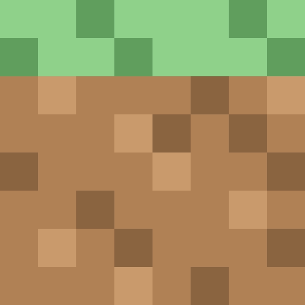
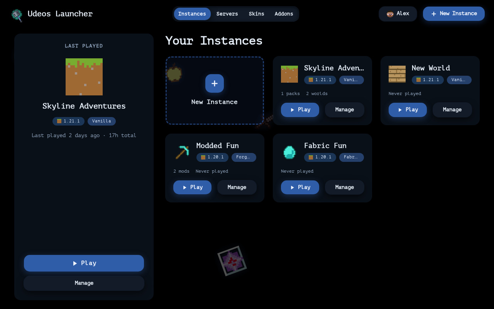
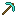
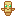
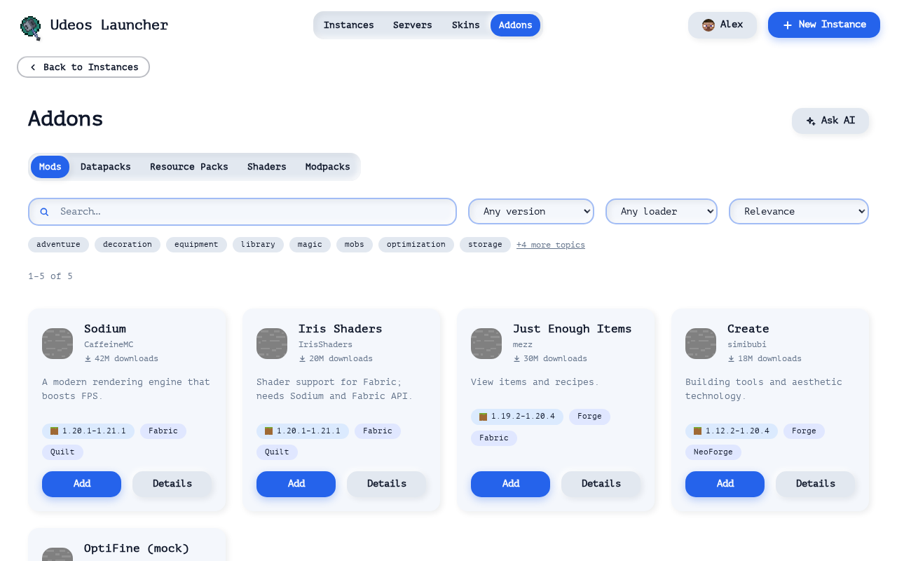
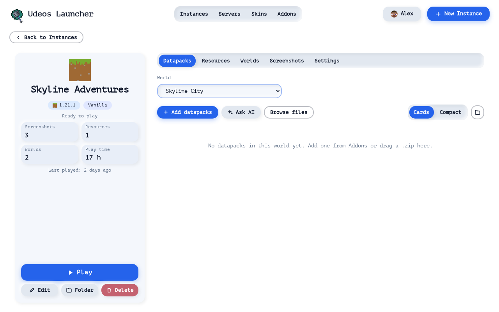
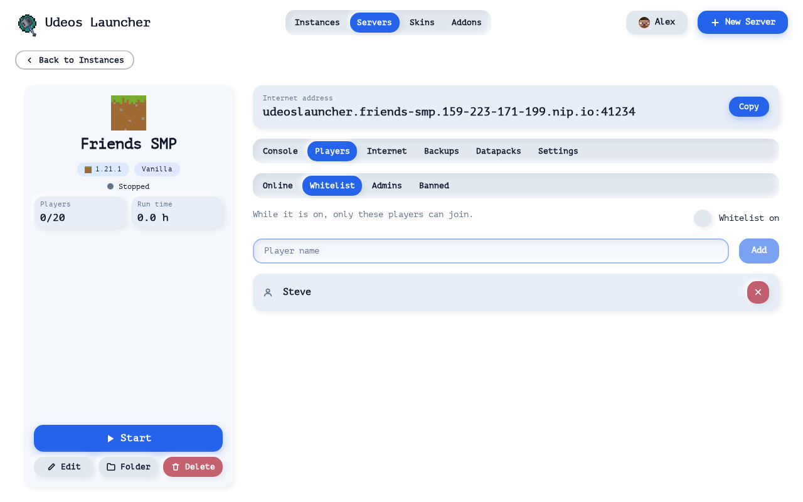
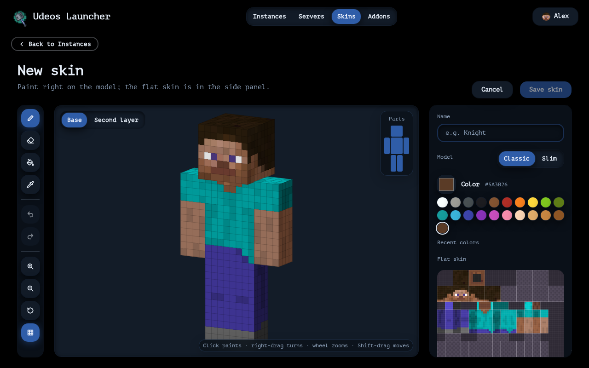
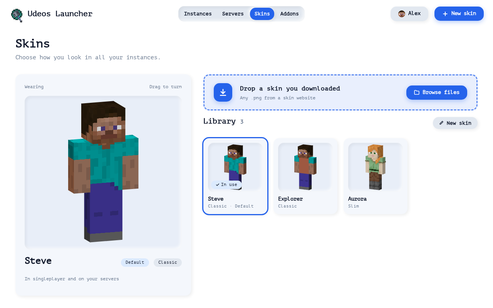
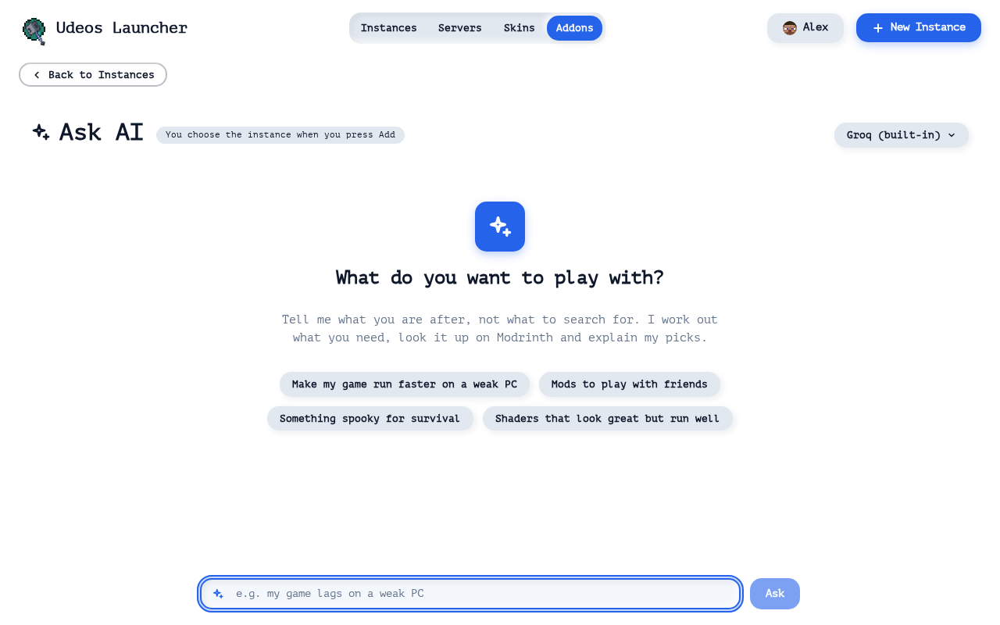

# Udeos Launcher

### Minecraft, your way. No account required.

A free desktop launcher for Windows, Linux and macOS. Pick a nickname, choose a
version, press Play. Mods, modpacks, skins, servers for your friends and an AI
helper are all built in.

[Download](#download) · [Features](#what-you-can-do) · [User guide](docs/user-guide/getting-started.md) · [Documentation](docs/README.md) · [Changelog](CHANGELOG.md)

 

 

## What is Udeos?

Udeos is a Minecraft: Java Edition launcher built for players who just want to
play. There is no sign-in screen and nothing to configure: you type a nickname,
create an instance for any version of the game and the launcher downloads
everything it needs, Java included.

Each instance is its own little world. It keeps its own worlds, mods, resource
packs and settings, so a heavily modded pack never touches your vanilla
survival save. When you want more, the launcher finds it for you: thousands of
mods, shaders and modpacks from Modrinth are one click away.

 

## What you can do

<table>
<tr>
<td width="50%" valign="top">

**Play any version**

Every release, snapshot and classic version Mojang has ever published. The
right Java runtime is downloaded for you.

</td>
<td width="50%" valign="top">

**Mods without the hassle**

Fabric, Quilt, Forge and NeoForge install themselves. No installer to run, no
folders to find.

</td>
</tr>
<tr>
<td valign="top">

**Browse thousands of addons**

Mods, datapacks, resource packs, shaders and modpacks from Modrinth, with
compatibility and dependencies checked before anything is installed.

</td>
<td valign="top">

**Ask the AI**

Say what you want ("my game lags on a weak PC") and get a short list of real
mods that fit, each with a reason.

</td>
</tr>
<tr>
<td valign="top">

**Host a server in a minute**

Create a server, press Start, share the address. Friends can join from
anywhere, even when your router does not cooperate.

</td>
<td valign="top">

**Your own skins**

Keep a skin library, paint new ones on a 3D model, and see them in
singleplayer and on your servers.

</td>
</tr>
<tr>
<td valign="top">

**Profiles for the whole family**

Several nicknames on one computer, each with its own instances, skins,
language and theme.

</td>
<td valign="top">

**Light and private**

Everything stays on your computer. The app is small, starts fast and updates
itself.

</td>
</tr>
</table>

 

## A quick tour

<table>
<tr>
<td width="50%"></td>
<td width="50%"></td>
</tr>
<tr>
<td align="center">Addons: search Modrinth and add with one click</td>
<td align="center">Every instance keeps its own worlds, packs and settings</td>
</tr>
<tr>
<td></td>
<td></td>
</tr>
<tr>
<td align="center">Servers with a ready-to-share internet address</td>
<td align="center">Paint skins straight on the 3D model</td>
</tr>
<tr>
<td></td>
<td></td>
</tr>
<tr>
<td align="center">A skin library for each profile</td>
<td align="center">Ask AI for suggestions in plain words</td>
</tr>
</table>

 

## Download

Get the newest version from the [Releases page](https://github.com/Juan17la/Udeos_Launcher/releases).

| System | File to pick |
|--------|--------------|
| Windows 10 and 11 | `...-windows-amd64-installer.exe` (or the portable `.zip`) |
| macOS (Intel and Apple Silicon) | `...-macos-universal.dmg` |
| Debian and Ubuntu | `...-linux-amd64.deb` |
| Fedora | `...-linux-x86_64.rpm` |
| Any other Linux | `...-linux-amd64.tar.gz` |

You do not need to install Java. The builds are not code-signed yet, so the
first time you open the app Windows SmartScreen or macOS Gatekeeper asks you to
confirm. The [getting started guide](docs/user-guide/getting-started.md) walks
you through it.

 

## Good to know

- **Udeos uses offline mode.** You play singleplayer, LAN worlds, your own
  servers and any server that accepts offline players. Servers that require a
  Microsoft account (most big public networks) will not let you in.
- **Nothing is uploaded.** Your nickname, instances and skins live only on your
  computer. The launcher connects out only to download game files, addons and
  updates, and to the AI provider when you use Ask AI.
- **Udeos is not affiliated with Mojang or Microsoft.** Minecraft is a
  trademark of Mojang AB. Please support the game by buying it.

 

## Documentation

| I want to... | Read |
|--------------|------|
| Learn how to use the launcher | [User guide](docs/user-guide/getting-started.md) |
| Fix a problem | [Troubleshooting](docs/user-guide/troubleshooting.md) |
| Understand how it works inside | [Documentation index](docs/README.md) |
| Build it or help out | [Contributing](CONTRIBUTING.md) |

 

## License

Udeos Launcher is source-available under the
[PolyForm Noncommercial License 1.0.0](LICENSE). You are free to use it, read
the code, modify it and share it for any noncommercial purpose. Selling it, or
using it or any part of it to make money, is reserved to the author. For
commercial permission, open an issue or contact
[@Juan17la](https://github.com/Juan17la).

 
Made by Juan Diego López Arias

