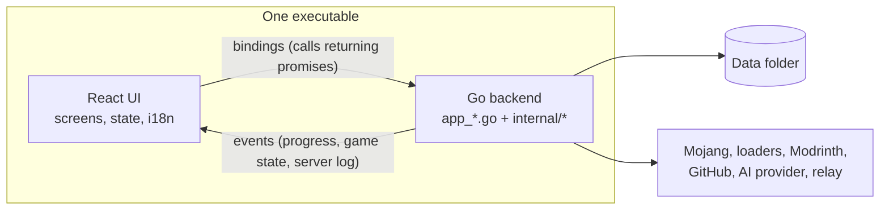

# Architecture overview

## One window, two programs

Udeos is a [Wails v2](https://wails.io) desktop application. Wails packages two
programs into a single executable:

1. A Go backend, the part that touches the machine. It talks to Mojang,
   Modrinth and the loader servers, writes files, unpacks archives, starts Java
   and watches the game and server processes.
2. A web frontend (React and TypeScript) rendered by the operating system's own
   web view: WebKitGTK on Linux, WebView2 on Windows, WKWebView on macOS. No
   browser is bundled, which keeps the binary small and the memory use far
   below an Electron app.



The frontend never reaches the network or the filesystem itself. That is the
whole contract between the halves:

- Bindings: every exported method on the `App` struct (in the `app_*.go`
  files) becomes a JavaScript function that returns a promise. Wails generates
  them into `frontend/wailsjs/` on each build.
- Events: Go pushes named events that the UI subscribes to.

| Event | Payload | Sent when |
|-------|---------|-----------|
| `install:progress` | `download.Progress` | A game, Java or loader install makes progress |
| `content:progress` | `download.Progress` | An addon or modpack download makes progress |
| `game:state` | `core.GameEvent` | A game starts running or exits |
| `server:log` | `{id, line}` | A server prints a console line |
| `server:state` | `{id}` | A server changes state (the UI re-reads `ListServers`) |
| `app:close` | `{running}` | The window is closing while servers run |

## Repository layout

```
.
├── main.go            window options and Wails bootstrap
├── app.go             the App struct: wiring at startup, shutdown, events
├── app_*.go           bindings, one file per feature
├── cmd/udeoscli/      a command line tool over the same core package
├── internal/          backend packages, one job each (below)
├── frontend/          React + TypeScript UI built with Vite and Tailwind 4
├── build/             app icon and Linux packaging (nfpm, .desktop)
├── docs/              this documentation
└── .github/workflows/ CI and the release pipeline
```

## Backend packages

Each package under `internal/` has one job. They are listed roughly in the
order a Play click goes through them.

| Package | Job |
|---------|-----|
| `paths` | Where the data folder is on each OS, and the name of every sub-folder. Nothing else hard-codes a path. |
| `profile` | The local player: nicknames, offline UUIDs, language, theme and colours per nickname, consent. |
| `instance` | The instance list (`instances.json`) and each instance's private game folder. A server is an instance with a flag. |
| `mojang` | Go types for Mojang's JSON (manifest, version, asset index) and the small JSON HTTP client every service uses. |
| `rules` | Evaluates the OS, architecture and feature rules Mojang attaches to libraries and arguments. |
| `download` | The download pool: 8 workers, SHA-1 verification, retries, skip-if-present. |
| `cache` | `Fetch`, the one fetch-or-fallback helper for every remote list. |
| `install` | Turns a version id into files on disk: version JSON, libraries, natives, assets, client jar. |
| `jre` | Downloads the Java runtime Mojang publishes for each version. |
| `loader` | Installs Fabric, Quilt, Forge and NeoForge for clients and servers. |
| `launch` | Builds the Java command line in offline mode. |
| `content` | Reads and validates what is inside a game folder: worlds, screenshots, packs, mods, `level.dat`, `servers.dat`. |
| `modsearch` | Read-only marketplace client (Modrinth) with memory and disk caching. |
| `modinstall` | Plans and applies addon installs: version choice, dependencies, conflicts, `content.json`. |
| `modpack` | `.mrpack` modpacks into new instances or servers, and the `.udeos` join file. |
| `skin` | The skin library and the local Yggdrasil-compatible skin server. |
| `server` | `server.properties` and the player lists of a dedicated server. |
| `tunnel` | Client for the bore relay protocol (servers on the internet without router setup). |
| `upnp` | Asks the router to forward a port (SSDP plus two SOAP calls). |
| `ai` | The Ask AI advisor and its providers. |
| `sysinfo` | Total RAM, for the memory slider. |
| `sysopen` | Opens a folder in the OS file manager. |
| `core` | The orchestrator: prepares and launches games, runs servers, owns the managers above. |

`core.Launcher` is the one object that holds the managers (installer, Java,
loaders, search, content, modpacks, skins, servers). The Wails bindings and
the CLI both go through it, so the desktop UI has no install or launch logic of
its own.

## Frontend folders

| Folder | Holds |
|--------|-------|
| `api/` | The typed bridge to the Go bindings and events, and an in-memory mock used when the page runs in a normal browser. |
| `state/` | The app context (profile, instances, servers, current screen and history) plus `useLaunchController` (launch state, game events) and `useContentQueue` (the serial install queue). |
| `screens/` | One file per page; `instance/` and `server/` hold the tabbed pages. |
| `components/` | Pieces shared by several screens: navigation, dialogs, tags, the skin view. |
| `ui/` | Building blocks with no app knowledge: Button, Field, Dialog, StatusMessage, SegmentedControl, DropZone, icons. |
| `hooks/` | `useFileList` (what every file tab does) and `useAddAction` (the shared Add flow). |
| `utils/` | Plain logic with no React: validation, formatting, errors, compatibility, search rules, the Markdown renderer, the skin renderer. |
| `theme/` | Design tokens (`tokens.css`). |
| `i18n/` | English and Spanish strings. |
| `assets/` | Minecraft textures used as icons, the default skins. |

[Frontend](frontend.md) and [Design system](design-system.md) cover this side in
detail.

## The command line tool

`cmd/udeoscli` calls the same `core` package from a terminal. It exists so the
download and launch pipeline can be tested without the desktop toolchain, and so
a failing launch can be reproduced without the UI.

```sh
go run ./cmd/udeoscli versions                     # list Minecraft versions
go run ./cmd/udeoscli loaders Forge                # game version -> loader build
go run ./cmd/udeoscli create "Modded" 1.20.1 Forge
go run ./cmd/udeoscli install <instance id>        # game + Java + loader
go run ./cmd/udeoscli add <instance id> iris       # an addon, with its dependencies
go run ./cmd/udeoscli modpack <slug> 1.20.1 forge  # a modpack as a new instance
go run ./cmd/udeoscli play <instance id>
```

Set `UDEOS_HOME` to a scratch folder to keep test runs away from your real
data.
