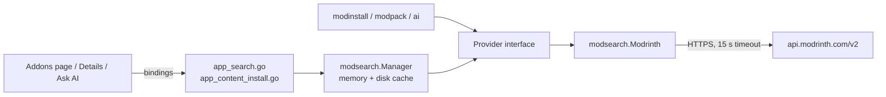

# Modrinth client

[Modrinth](https://modrinth.com) is the only source of addons. Everything the
Addons page, the Details page, the install planner, modpacks and Ask AI know
about a mod comes through one read-only client in `internal/modsearch`. This
page explains how that client connects, what it asks for and how it caches.
How an addon is then installed is in [Content installation](content-installation.md).

## Layers



- `Provider` is a small interface (`provider.go`). The rest of the launcher
  only knows the interface, so another marketplace could be added without
  touching the UI or the bindings. `Modrinth` is the only implementation today.
- `Modrinth` (`modrinth.go`) turns calls into HTTP requests and Modrinth's JSON
  into the launcher's own types (`Result`, `Version`, `ProjectInfo`,
  `ProjectDetail`).
- `Manager` (`manager.go`) wraps the provider with caching for the browse
  calls. The install planner, modpacks and the AI call the provider directly,
  because they need fresh data.

## The connection

The client reuses `mojang.Client`, the launcher's one JSON HTTP client:

| Setting | Value | Why |
|---------|-------|-----|
| Base URL | `https://api.modrinth.com/v2` | Modrinth's public API; no key or account needed |
| Timeout | 15 seconds | Shorter than the 60 s default: a slow browse should fall back to the cache rather than freeze the page |
| User agent | `UdeosLauncher` | Identifies the launcher to Modrinth |
| Errors | Any status other than 200 is an error that names the URL and status | The caller decides whether to fall back to cache |

Files (the mods themselves, icons, gallery images) are not fetched by this
client. Their URLs point at `cdn.modrinth.com` and are downloaded by
`download.Pool`, which verifies each one by hash. See
[Networking](networking.md).

## Endpoints

| Provider method | Request | Used by |
|-----------------|---------|---------|
| `Search` | `GET /search?query=&facets=&offset=&limit=&index=` | Addons page, Ask AI |
| `GameVersions` | `GET /tag/game_version` | Version filter |
| `Categories` | `GET /tag/category` | Topic chips, Ask AI's allowed categories |
| `Versions` | `GET /project/{id}/version?game_versions=[..]&loaders=[..]` | Choosing which build to install, Versions tab |
| `VersionByID` | `GET /version/{id}` | Dependencies pinned to one version |
| `VersionsByHashes` | `POST /version_files` with `{hashes, algorithm: "sha1"}` | Naming the files of a modpack or join file |
| `Projects` | `GET /projects?ids=[..]` | Titles, icons and descriptions for many projects in one call |
| `ProjectDetail` | `GET /project/{id}` | Details page, the Add picker's compatibility check |

List parameters are JSON arrays, as Modrinth expects
(`?loaders=["fabric","quilt"]`).

### Search facets

Modrinth filters with `facets`: a JSON array of OR-groups that are ANDed
together. `buildFacets` always produces:

```json
[["project_type:mod"], ["categories!=datapack"], ["versions:1.20.1"],
 ["categories:quilt", "categories:fabric"], ["categories:optimization"]]
```

- `project_type` is always there. For `mod` a `categories!=datapack` group is
  added, because Modrinth files datapacks as mods with a `datapack` loader tag;
  the Datapacks tab asks for `project_type:datapack` instead.
- The version group appears only when a version is picked.
- The loader group appears only for mods and modpacks. A Quilt instance asks
  for Quilt or Fabric (`LoaderNames`), since Quilt runs Fabric mods.
- Each topic chip adds its own group, so several topics narrow the results.

The sort is `index`: `downloads`, `newest` or `updated`; it is left out for
relevance. Modrinth has no ascending order. The Addons page asks for 30 results
a page; the client defaults to 20 and never asks for more than 50.

### What a result carries

Modrinth mixes loaders into its category list, so `loadersFrom` keeps only the
four the launcher can run. `releasesFrom` keeps plain release numbers out of the
version list (no snapshots or release candidates), which is what the version
tag on a card shows. Descriptions are cut at 160 characters on a word boundary,
since the card only shows two lines.

## Caching

Browsing goes through `Manager`, which has two layers:

| Layer | Holds | Lifetime | Read when |
|-------|-------|----------|-----------|
| Memory | Up to 64 search pages | 10 minutes each, oldest evicted first | First, on every search |
| Disk | One JSON file per distinct query in `cache/search/` | Until overwritten | Only when Modrinth cannot be reached |

- The disk file name is `<type>_<version>_<loader>_<sort>_<offset>_<hash>.json`,
  where the hash covers the text and topics.
- Free-text queries shorter than 3 characters are not written to disk, so typing
  does not create a file per keystroke.
- The game version and category lists are fetched once per run and kept in
  memory, with a disk copy as the offline fallback.
- `ProjectDetail` is not cached: it is fetched once, when Details is opened.

The disk layer is the shared `cache.Fetch` helper: write on success, read the
last copy on failure. With no network, the Addons page still shows every page
the player has seen before.

## Bindings

| Binding | Returns |
|---------|---------|
| `SearchContent(type, text, version, loader, sort, categories, offset, limit)` | `modsearch.Page` (`results`, `total`, `offset`) |
| `ListSearchGameVersions()` | Release versions for the version filter |
| `ListCategories(type)` | Topic names for one project type |
| `GetProjectDetail(id)` | The full project: body, gallery, links, every version and loader it supports |

The install bindings (`AddContent`, `ListProjectVersions`, `GetAlternatives` and
others) are in [Content installation](content-installation.md).

## Limits worth knowing

- Modrinth has no world or map project type, so there is no Worlds tab in
  Addons.
- The `loaders` filter on `/project/{id}/version` is loose for modpacks (asking
  for Forge can return Quilt and NeoForge builds), so modpack versions are
  filtered again on the client side.
- `GetProjectDetail` gives the versions and loaders aggregated across every
  release. That is enough to filter the Add picker, but a project can support
  1.20.1 on Fabric and on Forge without one release covering both. The install
  planner's per-version check stays the authority.
