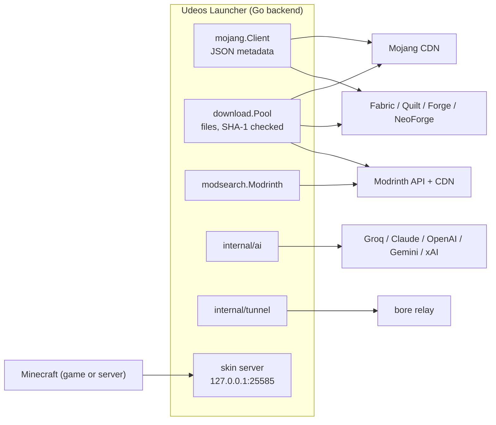

# Networking: every connection the launcher makes

The web view never touches the network. Every request leaves from the Go
backend, through a handful of small clients, and every remote list the UI shows
is cached on disk so the launcher keeps working offline. This page lists who
the launcher talks to, why, and how each connection behaves.

## The HTTP clients

There are only two ways a byte gets downloaded.

| Client | Package | Used for | Timeout | Behaviour |
|--------|---------|----------|---------|-----------|
| `mojang.Client` | `internal/mojang` | Small JSON documents: version lists, version JSONs, loader tables, Modrinth API calls, GitHub releases | 60 s (15 s for Modrinth) | `GET` or `POST` JSON, `User-Agent: UdeosLauncher`, any status other than 200 is an error. |
| `download.Pool` | `internal/download` | Every file that ends up on disk: libraries, assets, jars, Java runtimes, mods, packs, updates | 10 min per file | 8 parallel workers, SHA-1 verification, 3 attempts with a growing pause, skip when already valid. |

Modrinth uses a `mojang.Client` with a shorter 15 second timeout on purpose: a
browse query that takes longer should fall back to the cache instead of
freezing the page.

### How a file download stays safe

`download.Pool.Run(ctx, phase, tasks)` takes a list of `Task{URL, Path, SHA1,
Size}` and:

1. Skips any task whose file already exists with the right hash (or size, when
   no hash is known). This is what makes a second Play instant and lets an
   interrupted install resume.
2. Streams the body into `<path>.part` while hashing it.
3. Renames the `.part` file into place only when the SHA-1 matches. A corrupted
   or half-written file can never be mistaken for a good one.
4. Retries a failed file up to three times, then fails the whole run. The first
   error cancels the other workers.
5. Reports `Progress{phase, done, total, bytes, totalBytes, current}` after each
   file. The app forwards it to the UI as an event (`install:progress` for the
   game, `content:progress` for addons) so the two progress displays never mix.

## Offline fallback: `cache.Fetch`

Every remote list the UI shows goes through one generic helper,
`internal/cache.Fetch(path, source, fetch)`:

- the fetch succeeds: the result is written to `path` as JSON and returned;
- the fetch fails: the last copy at `path` is returned instead;
- there is no copy: the error says which service could not be reached.

| What | Cached at |
|------|-----------|
| Mojang version manifest | `versions/manifest.json` |
| Fabric, Quilt, Forge, NeoForge support tables | `cache/loaders/` |
| Modrinth search pages, game versions, categories | `cache/search/` |

Modrinth search adds a second layer in memory (`modsearch.Manager`): a page is
served from memory for 10 minutes, at most 64 pages are kept, and free-text
queries shorter than 3 characters are never written to disk, so typing does
not create a file per keystroke. See [Modrinth client](modrinth-client.md).

Files (jars, assets, mods) need no special cache: they are content-addressed by
hash, so once on disk they are valid forever. Addon files are kept in
`cache/content/<sha1>/` and reused by every instance.

## Who the launcher talks to

### Mojang (game files and Java)

All public and unauthenticated; no account or token is ever sent. Details in
[Installing from the CDN](cdn-installation.md).

| Host | What |
|------|------|
| `piston-meta.mojang.com` | Version manifest, version JSONs, asset indexes, Java runtime manifests |
| `piston-data.mojang.com` | Client and server jars, Java runtime files (URLs come from the JSONs above) |
| `libraries.minecraft.net` | Game libraries in Maven layout |
| `resources.download.minecraft.net` | Assets (sounds, textures, languages), addressed by hash |
| `api.mojang.com` | Only for servers set to "Microsoft accounts": turns a name into a real UUID for the whitelist |

### Mod loaders

Details in [Mod loaders](mod-loaders.md).

| Host | What |
|------|------|
| `meta.fabricmc.net/v2`, `maven.fabricmc.net` | Fabric versions, profile JSONs, libraries, server launcher |
| `meta.quiltmc.org/v3`, `maven.quiltmc.org` | Quilt, same protocol as Fabric |
| `files.minecraftforge.net`, `maven.minecraftforge.net` | Forge promotions, build list, installers, libraries |
| `maven.neoforged.net` | NeoForge build list and installers |

### Modrinth (addons)

| Host | What |
|------|------|
| `api.modrinth.com/v2` | Search, projects, versions, categories, hash lookups |
| `cdn.modrinth.com` | Addon files, icons, gallery images (URLs come from the API) |

Details in [Modrinth client](modrinth-client.md).

### Everything else

| Host | When | What |
|------|------|------|
| `api.github.com` (and GitHub's release downloads) | Once per start | Checks for a newer release, downloads it on Update. See [Self-update](#self-update). |
| `authlib-injector.yushi.moe` | First Play or server start | The skin agent jar, pinned by version and SHA-1. See [Skins](skins.md). |
| `api.groq.com`, `api.anthropic.com`, `api.openai.com`, `generativelanguage.googleapis.com`, `api.x.ai` | Only when Ask AI is used, only the chosen provider | See [AI advisor](ai-advisor.md). |
| `bore.pub:7835` (or your own relay) | While a server is open to the internet in Relay mode | See [Servers](servers.md). |
| Your router (SSDP on `239.255.255.250:1900`, then its UPnP control URL) | Router mode only | Port forwarding. |

`nip.io` is never contacted by the launcher. It is a public DNS service that
your friends' computers ask when they connect to a named server address.

## Local listeners

| Address | What |
|---------|------|
| `127.0.0.1:25585` (or any free port) | The skin server the game and Udeos servers ask for profiles and skins. Only accepts requests addressed to `127.0.0.1` or `localhost`. |
| The Wails asset server, path `/media/...` | Serves screenshots and modpack icons from disk to the web view without copying them. |
| Your servers' ports (25565 and up) | Only while a server runs. |

## Self-update

`app_update.go` asks `GET /repos/Juan17la/Udeos_Launcher/releases?per_page=1`
(not `/releases/latest`, because every release is marked as a pre-release) and
compares the tag with the version stamped into the binary at build time. A
development build (version `dev`) never offers an update.

Update downloads the asset that matches how the launcher was installed, through
the same `download.Pool` (size-checked), then:

| Installed from | Update runs |
|----------------|-------------|
| Windows installer | The new installer, through the shell so Windows can show the admin prompt |
| macOS `.dmg` | Opens the new `.dmg` |
| `.deb` | `pkexec apt-get install -y <file>` |
| `.rpm` | `pkexec dnf install -y <file>` |
| `.tar.gz` | Swaps the binary in place and restarts |

The launcher then quits, stopping running servers cleanly first.
