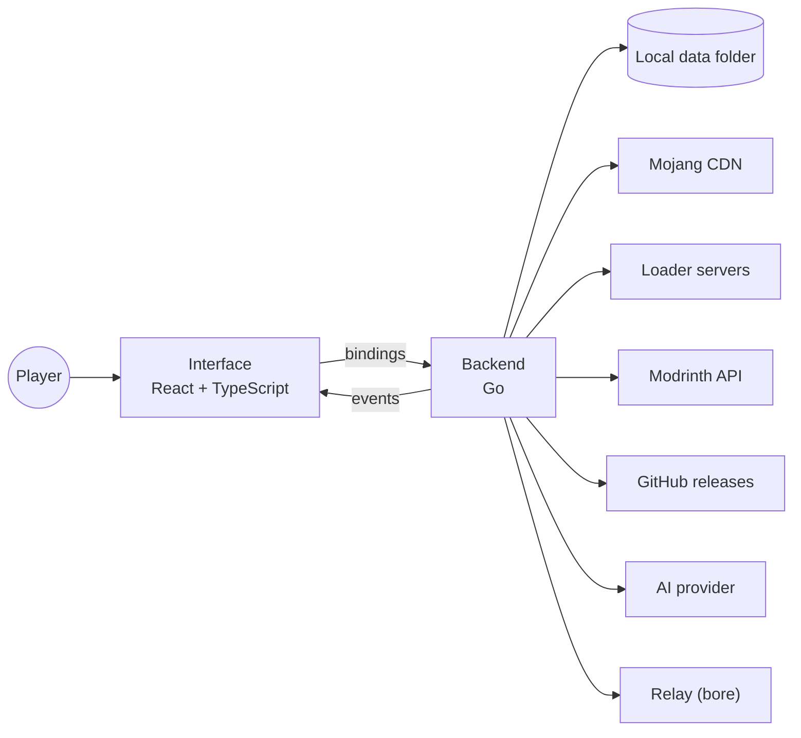

# Product overview

This section describes Udeos Launcher as a product: what it is, who it is for,
what it does and what it deliberately does not do. It is the starting point
for anyone who needs to understand the application before reading the
requirements, the use cases or the code.

| Document | Purpose |
|----------|---------|
| Overview (this page) | What the app is, the core concepts, scope and limits |
| [Feature catalogue](features.md) | Every feature, screen by screen |
| [Functional requirements](functional-requirements.md) | What the system must do, numbered and testable |
| [Non-functional requirements](non-functional-requirements.md) | How well it must do it: performance, security, usability, portability |
| [Use cases](use-cases.md) | Actors and the main interactions, step by step |
| [Design planning](../design-planning/mockups.html) | Mockups, design system, navigation flow and product vision (HTML) |

## 1. What Udeos Launcher is

Udeos Launcher is a free, open source (MIT) desktop application for Windows,
Linux and macOS that installs, organises and starts Minecraft: Java Edition.

It is built for players who want to play without friction. The player types a
nickname, creates an instance for any version of the game and presses Play.
The launcher downloads the game, its assets, the correct Java runtime and, if
asked, a mod loader, then starts the game. No Microsoft or Mojang account is
required: the game runs in offline mode with the chosen nickname.

Around that core the launcher bundles everything a player usually needs a
second or third tool for:

- mod loaders (Fabric, Quilt, Forge, NeoForge) installed automatically;
- the Modrinth catalogue (mods, datapacks, resource packs, shaders, modpacks)
  with compatibility and dependency checks;
- an AI advisor that turns a plain request into a short list of real addons;
- dedicated servers that friends can join from anywhere through a relay;
- a skin library and a 3D skin editor, with skins visible in singleplayer and
  on the player's own servers;
- several local profiles for people sharing one computer.

## 2. Problem and value

| Problem players face | How Udeos answers it |
|----------------------|----------------------|
| The official launcher requires an account and a purchase check before anything works | Offline nickname login, nothing to sign in to |
| Installing a mod loader means running a separate installer and finding folders | The loader is installed silently on first Play |
| Mods break each other or need dependencies the player does not know about | Every install is planned: version, loader, dependencies and conflicts are checked first |
| Keeping a modded pack separate from a vanilla survival world is manual | Each instance has its own isolated game folder |
| Hosting a world for friends requires port forwarding or paid hosting | One click starts a server and a relay gives it a public address |
| Players do not know which mod solves their problem | Ask AI suggests real Modrinth projects with a reason for each |
| Several people share one PC | Profiles keep instances, skins, language and theme apart |

## 3. Target audience

| Group | Profile | What they need most |
|-------|---------|---------------------|
| Casual players (primary) | Kids, teens and families, often on modest hardware, often sharing one PC | A short path to Play, plain language, big targets, no configuration |
| Modders and modpack players (primary) | Players who run several modded instances at once | Density, control over versions and loaders, fast content management |
| Hosts (secondary) | A player who wants to run a world for friends | A server that starts in one click and an address to share |
| Joining friends (secondary) | Players connecting to a host's server | A file or address that gets them in without setup |

The full persona and style rationale are in the
[product vision](../design-planning/vision.html).

## 4. Core concepts

| Concept | Definition |
|---------|-----------|
| Profile | A local nickname with its own instances, servers, skins, language and theme. The nickname is the in-game name. |
| Instance | One isolated copy of the game: its own folder, Minecraft version and loader, worlds, mods, packs and settings. |
| Loader | Fabric, Quilt, Forge or NeoForge: the layer that lets the game load mods. Vanilla means no loader. |
| Addon | Anything from Modrinth: a mod, datapack, resource pack, shader or modpack. |
| Server | An instance that runs Minecraft's dedicated server instead of the game client. |
| Relay | A public tunnel (bore protocol) that gives a server an internet address without router setup. |
| Join file (`.udeos`) | A small file a host shares so a friend can create an identical instance with the server already listed. |
| Skin library | A per-profile collection of skins served to the game by a local skin server. |
| Activity | The always-present tray that lists every running job, open game and running server. |

## 5. How it works, in one paragraph

Udeos is a [Wails v2](https://wails.io) application: a Go backend and a React
and TypeScript interface rendered by the operating system's own web view. The
backend owns everything that touches the machine or the network: it reads
Mojang's version manifest, downloads and verifies files into a shared cache,
installs loaders, plans addon installs against Modrinth, builds the Java
command line and supervises game and server processes. The interface calls
backend methods (bindings) and listens to backend events (progress, game state,
server logs). All data lives in one local folder per user. The
[architecture overview](../architecture/overview.md) explains each part.

## 6. Scope

### In scope

- Minecraft: Java Edition, every version in Mojang's manifest (releases,
  snapshots, old betas and alphas).
- Vanilla, Fabric, Quilt, Forge and NeoForge instances and servers.
- Modrinth as the single addon source.
- Offline-mode play, local skins, local profiles.
- English and Spanish interface.
- Windows 10 and 11 (x64), macOS (Intel and Apple Silicon), Linux x64 (`.deb`,
  `.rpm`, `.tar.gz`).

### Out of scope

| Not included | Reason |
|--------------|--------|
| Microsoft account login | The product promise is no account; offline mode is the design |
| Joining servers that require Microsoft authentication | Those servers reject offline players by design |
| Bedrock Edition, consoles, mobile | Different game and different distribution |
| CurseForge as an addon source | Modrinth's open API covers the catalogue; a second source doubles the checks |
| Cloud sync of instances or settings | Everything stays local by principle |
| Code-signed and notarized builds | Planned; builds currently ask the OS for confirmation on first open |

## 7. Constraints and assumptions

- The interface runs in the system web view (WebKitGTK on Linux), so visual
  effects are limited to what that engine renders smoothly.
- The smallest supported window is 960 by 640 pixels; the default is 1180 by 760.
- An internet connection is needed for the first install of any version,
  loader or addon. Already downloaded content works offline.
- The built-in AI key is shared by every player and can be rate limited; a
  personal key removes that limit.
- Minecraft is a trademark of Mojang AB. Udeos is not affiliated with Mojang or
  Microsoft and asks players to buy the game.

## 8. Quality goals at a glance

1. Press Play first: from opening the app to playing is the shortest path on screen.
2. Waiting is visible: every download, install and start shows progress where it happens.
3. Casual by default, dense on demand.
4. Light on weak PCs: small binary, low memory, no heavy effects.
5. Private: no account, no telemetry, nothing uploaded.

They are made measurable in the
[non-functional requirements](non-functional-requirements.md).
