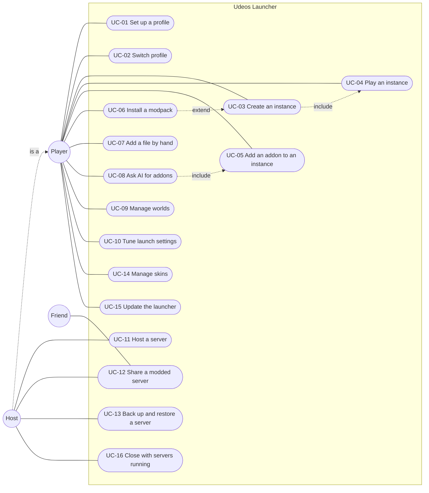

# Use cases

The interactions between the people and systems around Udeos Launcher and the
launcher itself. Each use case lists its actors, preconditions, main flow,
alternative flows and the requirements it covers (see
[functional requirements](functional-requirements.md)).

## Actors

| Actor | Kind | Description |
|-------|------|-------------|
| Player | Primary | Anyone using the launcher on their computer: casual player or modder. |
| Host | Primary | A player who runs a server for others. A specialisation of Player. |
| Friend | Secondary | Someone who joins a host's server, with Udeos or another launcher. |
| Mojang services | External system | Version manifest, game files, Java runtimes, server jars. |
| Loader services | External system | Fabric, Quilt, Forge and NeoForge metadata and installers. |
| Modrinth | External system | Addon search, project pages, files. |
| AI provider | External system | Groq (built-in) or the provider the player configured. |
| Relay | External system | The public bore relay that gives a server an address. |
| GitHub | External system | Release metadata and update packages. |

## Use case diagram

## Summary

| ID | Name | Primary actor | Priority |
|----|------|---------------|----------|
| UC-01 | Set up a profile | Player | Must |
| UC-02 | Switch or remove a profile | Player | Must |
| UC-03 | Create an instance | Player | Must |
| UC-04 | Play an instance | Player | Must |
| UC-05 | Add an addon to an instance | Player | Must |
| UC-06 | Install a modpack | Player | Must |
| UC-07 | Add a file by hand | Player | Should |
| UC-08 | Ask AI for addons | Player | Should |
| UC-09 | Manage worlds | Player | Must |
| UC-10 | Tune launch settings | Player | Should |
| UC-11 | Host a server for friends | Host | Must |
| UC-12 | Share a modded server | Host, Friend | Should |
| UC-13 | Back up and restore a server | Host | Must |
| UC-14 | Manage skins | Player | Should |
| UC-15 | Update the launcher | Player | Should |
| UC-16 | Close with servers running | Host | Must |

---

## UC-01 Set up a profile

| | |
|---|---|
| Actor | Player |
| Goal | Start using the launcher with a nickname, language and theme. |
| Precondition | First run, or Add profile chosen in the profile dialog. |
| Postcondition | A profile exists and is active; the Instances page is shown. |
| Requirements | FR-01.1 to FR-01.4, FR-01.7, FR-01.9 |

Main flow

1. The system shows the setup screen at the nickname step.
2. The player types a nickname.
3. The system validates it live (3 to 16 letters, digits, underscores; not taken).
4. The player presses Next and picks English or Spanish; the interface switches at once.
5. The player presses Next and picks Dark, Light or Custom; the preview applies live.
6. On first run the player ticks the privacy agreement (optionally reading it).
7. The player presses Start. The system creates the profile and opens Instances.

Alternative flows

- 3a. Invalid or taken nickname: Next stays disabled and a hint explains the rule.
- 5a. Custom: the player picks a base and an accent; the system derives a readable palette.
- 1a. Adding a profile: Cancel on the first step returns to the previous profile.

## UC-02 Switch or remove a profile

| | |
|---|---|
| Actor | Player |
| Precondition | At least one profile exists. |
| Postcondition | The chosen profile is active, with its instances, skins, language and theme. |
| Requirements | FR-01.5 to FR-01.7 |

Main flow

1. The player opens the profile button at the foot of the sidebar and chooses Switch profile.
2. The system lists the local profiles with their avatars.
3. The player picks one.
4. The system loads its data and theme and navigates to Instances.

Alternative flows

- 3a. Add profile: continues with UC-01.
- 3b. Remove: the system asks for confirmation, moves the removed profile's instances and skins to the remaining one, and deletes nothing.

## UC-03 Create an instance

| | |
|---|---|
| Actor | Player |
| Precondition | A profile is active. |
| Postcondition | A new instance exists; with Create & play it is installed and running. |
| Requirements | FR-02.4 to FR-02.8 |

Main flow

1. The player presses New Instance in the sidebar (or the dashboard tile).
2. The system shows the form with a default name, icon, Vanilla and the newest release.
3. The player edits name and icon and picks Vanilla or With mods plus a loader.
4. The system lists only versions the loader supports and names the loader build.
5. The player picks a version and presses Create & play.
6. The system creates the instance, opens its page and continues with UC-04.

Alternative flows

- 3a. From a modpack: the player searches a pack; continues with UC-06.
- 5a. Just create it: the system saves the instance and opens its page without installing.
- 1a. Import file: the player picks a `.udeos` file; the system pre-fills version, loader and mods and adds the server to the multiplayer list.
- 4a. Version list cannot load (offline, nothing cached): the system shows "Could not load the version list" with Retry.

## UC-04 Play an instance

| | |
|---|---|
| Actor | Player |
| Secondary actors | Mojang services, Loader services |
| Precondition | The instance exists. |
| Postcondition | The game is running with the profile's nickname and skin. |
| Requirements | FR-03.1 to FR-03.12 |

Main flow

1. The player presses Play on a card, the last-played panel or the instance page.
2. The system replaces Play with the launch strip and checks which files are missing.
3. The system downloads and verifies missing game files, assets and the Java runtime, showing phase and percentage.
4. If the instance has a loader not yet installed, the system installs it (bar turns gold, "slow on purpose").
5. The system starts the game in offline mode.
6. Play turns into a green Playing chip with elapsed time; Activity lists the game.
7. The player closes the game; the system records play time and shows "GG" once.

Alternative flows

- 2a. Everything is installed: steps 3 and 4 are skipped and the game starts within seconds.
- 3a. The player presses Cancel: the system stops the install and restores Play.
- 3b. A hash mismatch or network error: the system shows an error headline with detail; Play can be pressed again.
- 6a. The game freezes: the player presses Close game, confirms, and the system ends the process.
- 7a. The game exits with an error: the system shows the crash dialog with Open logs folder.

## UC-05 Add an addon to an instance

| | |
|---|---|
| Actor | Player |
| Secondary actors | Modrinth |
| Precondition | At least one instance exists. |
| Postcondition | The addon and its dependencies are in the instance. |
| Requirements | FR-05.1 to FR-05.11 |

Main flow (from an instance)

1. On a file tab, the player presses Add resources.
2. The system opens Addons locked to the instance's version and loader.
3. The player searches and optionally opens Details.
4. The player presses Add.
5. The system plans the install: compatible build, already installed, dependencies, conflicts.
6. The system queues the download; Activity shows progress; the card reads Added.

Alternative flows

- 1a. From the sidebar Addons: on Add, the system lists only compatible instances and the player picks one (two clicks total).
- 5a. No build for this version or loader: the system names the loader that is supported and installs nothing.
- 5b. Conflict: nothing is installed; See options suggests another version or similar projects.
- 5c. No compatible instance at all: a dialog offers Create instance.
- 3a. Details, Versions tab: the player picks a specific release; a different installed release is replaced.

## UC-06 Install a modpack

| | |
|---|---|
| Actor | Player |
| Precondition | None. |
| Postcondition | A new instance built from the pack, or the pack's mods merged into an instance. |
| Requirements | FR-05.12 |

Main flow

1. In Addons, Modpacks tab, the player presses Add on a pack.
2. The system offers New instance or a list of compatible modded instances.
3. The player chooses New instance.
4. The system creates the instance with the pack's version, loader and icon, downloads every mod and copies the pack's settings.

Alternative flows

- 3a. Existing instance: the system adds the pack's mods and never overwrites the player's files.
- 3b. New server from this modpack (from Details): continues with UC-11 with only server-side parts.

## UC-07 Add a file by hand

| | |
|---|---|
| Actor | Player |
| Postcondition | The file is in the right folder, or refused with a reason. |
| Requirements | FR-04.3, FR-04.4 |

Main flow

1. The player drags a file onto an instance tab, or presses Browse files.
2. The system inspects it (kind, loader).
3. The system copies it in and lists it as "Added by hand".

Alternative flows

- 2a. Wrong kind or loader: the system refuses it and says why.

## UC-08 Ask AI for addons

| | |
|---|---|
| Actor | Player |
| Secondary actors | AI provider, Modrinth |
| Postcondition | The player sees real addons grouped by need and can add them. |
| Requirements | FR-06.1 to FR-06.9 |

Main flow

1. The player opens Ask AI from Addons or from an instance tab.
2. The player types a goal or taps a suggestion.
3. The system sends the request (with instance version, loader and installed names when known) to the provider.
4. The system runs the planned Modrinth searches and keeps only real results.
5. The system shows what it understood, groups of picks with reasons and follow-up buttons.
6. The player presses Add on a pick; continues with UC-05 step 5.

Alternative flows

- 3a. The request is vague: the system asks one question first.
- 3b. Rate limited or provider error: a plain message suggests trying later or using a personal key.
- 1a. Settings: the player chooses a provider, pastes a key and picks a model; the key is stored locally and masked.

## UC-09 Manage worlds

| | |
|---|---|
| Actor | Player |
| Requirements | FR-04.6, FR-04.7 |

Main flow

1. The player opens the Worlds tab of an instance.
2. The player imports a folder or `.zip`; the system copies it, renaming on a clash.
3. The player presses Save to Device on a world; the system writes a `.zip`.

Alternative flows

- 3a. Delete: the system asks for confirmation, then removes the world.

## UC-10 Tune launch settings

| | |
|---|---|
| Actor | Player |
| Requirements | FR-04.9 |

Main flow

1. The player opens Settings on an instance.
2. The player moves the memory slider; the system colours unsafe values red.
3. The player optionally picks a Java executable and adds JVM arguments.
4. The player saves; the next launch uses the new values.

## UC-11 Host a server for friends

| | |
|---|---|
| Actor | Host |
| Secondary actors | Mojang services, Relay, Friend |
| Postcondition | A running server with an address friends can use. |
| Requirements | FR-07.1 to FR-07.9 |

Main flow

1. The host opens Servers and presses New Server.
2. The host picks Vanilla, With mods or From a modpack, a version, a name and an icon, and accepts the EULA.
3. The system creates the server and opens its page.
4. The host presses Start.
5. The system downloads the server (first time), starts it and opens the relay; status goes Starting then Ready.
6. The host presses Copy on the internet address and sends it to friends.
7. Friends join from their multiplayer list; Players shows them online.

Alternative flows

- 4a. Two servers already running: the system asks before starting a third.
- 5a. Router mode: the system asks the router (UPnP); on failure the Internet tab explains it and suggests the relay.
- 7a. A friend on another launcher sees "Invalid session": the host sets Who can join to Anyone.

## UC-12 Share a modded server

| | |
|---|---|
| Actors | Host, Friend |
| Precondition | A modded server that has started at least once. |
| Requirements | FR-07.12, FR-02.8 |

Main flow

1. The host presses Save file for friends and sends the `.udeos` file.
2. The friend opens New Instance, presses Import file and picks it.
3. The friend's launcher creates the identical instance with the server listed.
4. The friend presses Play and joins.

## UC-13 Back up and restore a server

| | |
|---|---|
| Actor | Host |
| Requirements | FR-07.10 |

Main flow

1. On the Backups tab the host presses Back up now; the system writes a consistent `.zip` (pausing saves if running).
2. Later, with the server stopped, the host presses Restore on a backup.
3. The system backs up the current world, then restores the chosen one.

Alternative flows

- 2a. Server running: Restore is unavailable until it is stopped.

## UC-14 Manage skins

| | |
|---|---|
| Actor | Player |
| Requirements | FR-08.1 to FR-08.7 |

Main flow

1. The player opens Skins and drops a `.png` on the window.
2. The system names it, guesses Classic or Slim and adds it to the library.
3. The player clicks the card to wear it; the avatar updates.
4. On the next Play the skin shows in game.

Alternative flows

- 1a. New skin: the editor opens on Steve or Alex; the player paints and saves.
- 3a. Edit from a card: the editor opens with that skin.
- 3b. Delete: confirmation, then removal. Steve cannot be removed.

## UC-15 Update the launcher

| | |
|---|---|
| Actor | Player |
| Secondary actors | GitHub |
| Requirements | FR-09.6 |

Main flow

1. On start the system finds a newer release.
2. The system shows the update dialog with the version.
3. The player presses Update; the system downloads the right package and installs it.

Alternative flows

- 3a. Later: the dialog closes until next start.
- 3b. Linux package install: the OS asks for a password; cancelling stops the update.

## UC-16 Close with servers running

| | |
|---|---|
| Actor | Host |
| Requirements | FR-09.7, NFR-10 |

Main flow

1. The host closes the window while a server runs.
2. The system shows the close dialog listing running servers.
3. The host confirms; the system stops each server, waits for the save and exits.

Alternative flows

- 3a. Cancel: nothing changes.
